# Product engineering for real operations

> Ranielli Montagna — Software Engineer at Lemon Energia

I turn business and operational context into reliable web and mobile products, APIs, automation and AI-enabled workflows.

---

## How I work

**Now — Lemon Energia.** I work at the intersection of the Center of Excellence and business areas, translating operational needs into clearer processes, digital solutions and reliable automation. I use AI pragmatically when it reduces repetitive work, organizes context or supports better decisions.

**Proven foundation — Luizalabs.** I contributed to inventory and logistics workflows across 1,000+ Magalu stores and the daily work of 1,000+ stock clerks. I also led frontend initiatives in SaaS products, created a Design System adopted across products, established quality practices and mentored developers.

**How I approach problems.** With 5+ years in software engineering, I connect business context, product delivery, LLMs, automation, agents and Model Context Protocol workflows to make operations more efficient and decisions clearer.

## Operating focus

- **Business systems** — discovery, process clarity and technology decisions tied to how teams actually operate.
- **AI & automation** — LLM-enabled workflows, agents, custom tools and decision support with useful guardrails.
- **Product engineering** — accessible web and mobile products, REST APIs, integrations and dependable delivery.

## Craft & stack

**Product engineering:** React, React Native, TypeScript, Next.js and Tailwind CSS.

**Systems & delivery:** Node.js, REST APIs, PostgreSQL, Docker, CI/CD and product-quality practices.

**AI & automation:** LLM workflows, agents, Model Context Protocol and developer tooling.

## Experience

**Lemon Energia — Software Engineer**

Engineering at the bridge between the Center of Excellence and business areas: digital solutions, automation and applied AI.

**Luizalabs — Software Engineer**

Web and mobile products, REST APIs, integrations and micro frontends for national retail operations.

**Smarten — Front-end Tech Lead**

Frontend architecture, Design System, CI/CD, monitoring, mentoring and product delivery.

**SBSistemas — Front-end Developer**

React, Electron, TypeScript, reusable components and interface engineering practices.

## Featured projects

- **[agent-toolkit](https://github.com/raniellimontagna/agent-toolkit)** — Node.js CLI that installs a pinned set of coding-agent tools and skills across Claude Code, Codex CLI, OpenCode, Gemini CLI and Antigravity.
- **[full-page-shot](https://github.com/raniellimontagna/full-page-shot)** — Chrome extension that captures the whole scrollable page, the visible area or a dragged region to the clipboard or a file, fully local.
- **[klick](https://github.com/raniellimontagna/klick)** — Minimalist Rubik's Cube timer and scrambler with sessions, statistics and offline support. Live at [klick.ranimontagna.com](https://klick.ranimontagna.com).
- **[jev-guard-mcp](https://github.com/raniellimontagna/jev-guard-mcp)** — Experimental MCP server where Jev picks among code-owned browser actions, run in an isolated Playwright context after explicit human approval.
- **[fadenbrett](https://github.com/raniellimontagna/fadenbrett)** — Self-hosted investigation board: connect characters, events and theories with red strings on an infinite canvas.
- **[tab-switch](https://github.com/raniellimontagna/tab-switch)** — Browser extension that rotates through configured tabs automatically, for presentations and monitoring dashboards.
- **[ranimontagna.com](https://github.com/raniellimontagna/ranimontagna.com)** and **[links.ranimontagna.com](https://github.com/raniellimontagna/links.ranimontagna.com)** — my portfolio and blog (Next.js) and my links page (Astro).

## GitHub activity

  
  

> These visuals track public GitHub activity. Private production work and business impact are not fully represented here.
